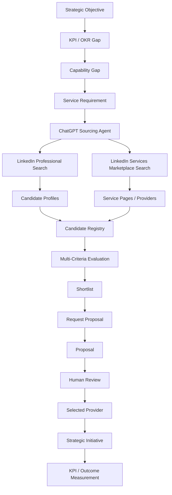

# JFXBSC / OpenBSC AI
## ChatGPT Plugin + LinkedIn Services Marketplace Integration Architecture

> **Project:** `robotics-intelligent-systems/jfxbsc`  
> **Purpose:** Extend OpenBSC AI with a strategic external-capability sourcing layer that connects Balanced Scorecard objectives, KPI/OKR gaps, initiatives, ChatGPT plugins/apps, and LinkedIn Services Marketplace workflows.
>
> **Architecture principle:** LinkedIn and ChatGPT remain **optional external integration services**. The OpenBSC AI core stays modular, auditable, provider-neutral, and replaceable.

---

# 1. Existing OpenBSC AI Context

OpenBSC AI already organizes strategy execution as:

```text
Strategy
   ↓
Objectives
   ↓
KPIs / OKRs
   ↓
Enterprise Data
   ↓
Analytics
   ↓
AI
   ↓
Decisions
   ↓
Initiatives
   ↓
Outcomes
   ↓
Feedback
```

The repository also defines:

- Balanced Scorecard perspectives;
- strategy maps;
- KPI/OKR governance;
- semantic metrics;
- business intelligence;
- forecasting;
- AI-assisted analysis;
- RAG;
- AI agents;
- multi-criteria decision support;
- process/value-stream analytics;
- enterprise integration;
- MBSE → CAD → CAM → CAS traceability.

The proposed extension adds a **Strategic Services Sourcing** capability.

---

# 2. New Strategic Services Sourcing Loop

```text
Strategic Objective
       ↓
KPI / OKR Gap
       ↓
Capability Gap
       ↓
Build / Buy / Partner Decision
       ↓
External Service Requirement
       ↓
ChatGPT Sourcing Assistant
       ↓
LinkedIn Provider Discovery
       ↓
Services Marketplace / Request for Proposal
       ↓
Provider Evaluation
       ↓
Human Selection
       ↓
Engagement / Contract
       ↓
Initiative Execution
       ↓
KPI Outcome
       ↓
Balanced Scorecard Feedback
```

This turns external professional services into measurable strategic initiatives rather than isolated procurement events.

---

# 3. High-Level Integration Architecture

```text
┌─────────────────────────────────────────────────────────────────────┐
│                         OPENBSC AI                                  │
│                                                                     │
│ Strategy Map | Objectives | KPIs | OKRs | Initiatives | Risks      │
└───────────────────────────────┬─────────────────────────────────────┘
                                │
                                ▼
┌─────────────────────────────────────────────────────────────────────┐
│                  STRATEGIC CAPABILITY GAP ENGINE                    │
│                                                                     │
│ KPI Gap | Skill Gap | Process Gap | Technology Gap | Capacity Gap  │
└───────────────────────────────┬─────────────────────────────────────┘
                                │
                                ▼
┌─────────────────────────────────────────────────────────────────────┐
│                    SERVICES SOURCING AGENT                          │
│                                                                     │
│ Requirement Builder | Search Plan | Evaluation | Recommendation     │
└───────────────────────────────┬─────────────────────────────────────┘
                                │
                ┌───────────────┴────────────────┐
                ▼                                ▼
┌───────────────────────────┐       ┌───────────────────────────────┐
│ CHATGPT PLUGIN / APP      │       │ INTERNAL KNOWLEDGE / RAG      │
│ ORCHESTRATION             │       │ policies / budgets / vendors  │
└─────────────┬─────────────┘       └───────────────────────────────┘
              │
              ▼
┌─────────────────────────────────────────────────────────────────────┐
│                   LINKEDIN INTEGRATION BOUNDARY                     │
│                                                                     │
│ Connected LinkedIn App / People Search                             │
│ LinkedIn Services Marketplace / Service Pages                      │
│ User-approved navigation / proposal workflow                       │
└───────────────────────────────┬─────────────────────────────────────┘
                                │
                                ▼
┌─────────────────────────────────────────────────────────────────────┐
│                    PROVIDER CANDIDATE MODEL                         │
│                                                                     │
│ Skills | Experience | Location | Service Category | Evidence       │
│ Reviews | Connections | Availability | Proposal | Cost             │
└───────────────────────────────┬─────────────────────────────────────┘
                                │
                                ▼
┌─────────────────────────────────────────────────────────────────────┐
│                 MULTI-CRITERIA DECISION SUPPORT                     │
│                                                                     │
│ Fit | Quality | Cost | Risk | Delivery | Strategic Alignment       │
└───────────────────────────────┬─────────────────────────────────────┘
                                │
                                ▼
                        HUMAN APPROVAL
                                │
                                ▼
                    STRATEGIC INITIATIVE
                                │
                                ▼
                    KPI / OKR MEASUREMENT
```

---

# 4. ChatGPT Plugin Role

Current ChatGPT plugin architecture allows plugins to bundle workflow capabilities and underlying apps that connect ChatGPT to external data and actions.

Within JFXBSC, ChatGPT should act as an **external conversational orchestration surface**, not as the system of record.

Recommended responsibilities:

- translate strategy gaps into service requirements;
- summarize internal project context;
- formulate provider-search criteria;
- retrieve supported LinkedIn professional profiles through the connected LinkedIn app;
- help compare provider candidates;
- create evaluation matrices;
- draft request-for-proposal text;
- summarize proposals entered into OpenBSC;
- connect selected engagements back to strategic initiatives and KPIs.

OpenBSC remains authoritative for:

- objectives;
- KPIs;
- budgets;
- initiative ownership;
- approved supplier decisions;
- strategic outcome measurement.

---

# 5. Current LinkedIn Connector Boundary

The currently available LinkedIn connector in ChatGPT should be modeled conservatively.

Its present professional-search capability is suitable for:

```text
Known Person / Candidate
        ↓
Name + Optional Filters
        ↓
LinkedIn Professional Profile Search
        ↓
Profile Context
        ↓
OpenBSC Provider Candidate
```

It should **not** be assumed to provide native LinkedIn Services Marketplace transaction APIs unless LinkedIn explicitly exposes and authorizes those actions.

Therefore the architecture separates:

```text
CHATGPT LINKEDIN APP
professional-profile discovery
        │
        │ optional context
        ▼
PROVIDER CANDIDATE

LINKEDIN SERVICES MARKETPLACE
service categories
service pages
request for proposal
provider messaging
        │
        │ external marketplace workflow
        ▼
PROPOSAL / ENGAGEMENT
```

---

# 6. LinkedIn Services Marketplace Workflow

LinkedIn currently allows clients to:

- search for service providers;
- browse Service Pages;
- request proposals;
- receive provider proposals;
- message providers;
- agree final commercial terms outside LinkedIn.

Recommended JFXBSC mapping:

```text
OpenBSC Service Requirement
        ↓
LinkedIn Services Search
        ↓
Provider Service Page
        ↓
Request Proposal
        ↓
Provider Response
        ↓
Proposal Imported / Registered in OpenBSC
        ↓
Evaluation
        ↓
Selection
        ↓
Contract Managed Externally
        ↓
Initiative Execution
```

---

# 7. Important Marketplace Integration Constraint

Do not design the OpenBSC core around an undocumented LinkedIn Marketplace API.

Preferred hierarchy:

1. official LinkedIn connector/app action, if and when available;
2. official LinkedIn API explicitly authorized for the use case;
3. user-driven Services Marketplace workflow;
4. structured manual import into OpenBSC;
5. optional browser workflow through an authorized interactive environment.

Avoid:

- scraping;
- DOM extraction;
- session-cookie reuse;
- credential automation;
- bypassing LinkedIn access controls;
- bulk extraction not authorized by LinkedIn.

---

# 8. Balanced Scorecard Perspective Mapping

## Financial Perspective

External-service sourcing can support:

- reduce cost of strategic initiatives;
- improve return on consulting spend;
- reduce sourcing cycle time;
- improve budget predictability;
- increase project ROI.

Example KPIs:

```text
External Service Cost Variance
Consulting ROI
Cost per Strategic Initiative
Proposal-to-Contract Cost Delta
Budget Utilization
```

---

## Customer Perspective

Potential objectives:

- improve customer experience;
- accelerate specialist delivery;
- add expert capabilities;
- improve service quality.

Example KPIs:

```text
Customer Satisfaction
Delivery Quality
Service-Level Compliance
Time to Resolve Capability Gap
External Expertise Impact
```

---

## Internal Process Perspective

Potential objectives:

- reduce provider-selection cycle time;
- increase proposal quality;
- standardize supplier evaluation;
- improve vendor onboarding.

Example KPIs:

```text
Time to Shortlist
Time to Proposal
Time to Contract
Provider Evaluation Completion Rate
Initiative Delivery Cycle Time
```

---

## Learning & Growth Perspective

Potential objectives:

- access external expertise;
- transfer knowledge internally;
- expand professional networks;
- close skills gaps.

Example KPIs:

```text
Skills Gap Closure Rate
Knowledge Transfer Completion
External Expert Hours
Internal Capability Improvement
Repeat Collaboration Rate
```

---

# 9. Strategic Capability Gap Model

```yaml
capability_gap:
  id: ai_sales_automation
  strategic_objective: improve_sales_productivity
  perspective: internal_process
  current_score: 42
  target_score: 75
  gap_type: external_expertise
  required_skills:
    - CRM architecture
    - AI agents
    - RAG
    - LinkedIn sales workflows
  budget_ceiling: 12000
  target_start: 2026-10
  owner: sales_operations
```

This object becomes the input to the sourcing workflow.

---

# 10. Service Requirement Object

```yaml
service_requirement:
  id: sr_2026_001
  capability_gap: ai_sales_automation
  title: AI CRM and LinkedIn Sales Workflow Architecture
  category: technology_consulting
  required_outcomes:
    - reference architecture
    - working prototype
    - CRM integration plan
    - KPI dashboard
  must_have_skills:
    - enterprise architecture
    - CRM
    - AI
    - APIs
  preferred_skills:
    - MCP
    - open source
    - LinkedIn Sales Navigator
  geography:
    preferred:
      - Argentina
      - LATAM
    remote_allowed: true
  budget:
    maximum: 12000
    currency: USD
```

---

# 11. ChatGPT Services Sourcing Agent

```text
Strategic Gap
      ↓
Service Requirement
      ↓
ChatGPT Sourcing Agent
      │
      ├── interpret requirement
      ├── generate search criteria
      ├── search supported profiles
      ├── draft marketplace search
      ├── draft RFP
      ├── summarize provider evidence
      └── prepare evaluation matrix
      ↓
Human Procurement / Business Owner
```

The agent recommends; it does not autonomously hire.

---

# 12. Proposed Agent Roles

```text
                     BSC AI ORCHESTRATOR
                             │
       ┌─────────────┬───────┼──────────┬─────────────┐
       ▼             ▼       ▼          ▼             ▼
   Strategy       Services Provider   Finance       Risk
    Agent          Agent    Agent      Agent        Agent
       │             │       │          │             │
       └─────────────┴───────┼──────────┴─────────────┘
                             ▼
                       Governed Tools
                             │
       ┌──────────────┬──────┼───────────────┐
       ▼              ▼      ▼               ▼
    Metrics         RAG   LinkedIn App    Vendor DB
```

### Strategy Agent
Identifies strategic objectives requiring external capability.

### Services Agent
Transforms gaps into service requirements and sourcing plans.

### Provider Agent
Compares candidate providers using professional evidence.

### Finance Agent
Evaluates cost, budget, ROI, and financial impact.

### Risk Agent
Evaluates delivery, dependency, data, legal, and supplier risks.

---

# 13. Provider Candidate Model

```yaml
provider_candidate:
  id: provider_001
  source: linkedin
  source_type: professional_profile
  service_category: software_development
  professional_profile:
    name: "..."
    title: "..."
    company: "..."
    location: "..."
  evidence:
    skills: []
    relevant_projects: []
    recommendations: []
    service_page: null
  evaluation:
    strategic_fit: null
    technical_fit: null
    delivery_fit: null
    commercial_fit: null
    risk_score: null
  provenance:
    retrieved_at: "..."
    source_reference: "..."
```

Only professional and service-relevant information should be used.

---

# 14. Proposal Object

```yaml
proposal:
  id: proposal_001
  requirement_id: sr_2026_001
  provider_id: provider_001
  source: linkedin_services_marketplace
  amount: 8500
  currency: USD
  delivery_days: 45
  scope:
    - architecture
    - prototype
    - documentation
  assumptions: []
  exclusions: []
  received_at: "..."
  status: under_review
```

---

# 15. Multi-Criteria Provider Evaluation

OpenBSC already supports multi-criteria decision support.

Recommended provider model:

```text
Provider Score =
    Strategic Alignment
  + Technical Fit
  + Demonstrated Experience
  + Delivery Capability
  + Cost / Value
  + Availability
  + Communication
  + Risk
```

Example weighting:

| Criterion | Weight |
|---|---:|
| Strategic alignment | 20% |
| Technical/professional fit | 20% |
| Demonstrated experience | 15% |
| Delivery capability | 15% |
| Cost/value | 10% |
| Availability | 10% |
| Communication / responsiveness | 5% |
| Risk | 5% |

Weights must be configurable.

---

# 16. Explainable Provider Ranking

```text
Candidate Profiles
       ↓
Professional Evidence
       ↓
Normalized Criteria
       ↓
Weighted Score
       ↓
Sensitivity Analysis
       ↓
AI Explanation
       ↓
Human Selection
```

The AI explanation should show:

- why a provider scored highly;
- missing evidence;
- uncertainty;
- trade-offs;
- source provenance.

---

# 17. Prohibited Ranking Inputs

Do not use professional sourcing to rank candidates based on:

- physical attractiveness;
- inferred age;
- race or ethnicity;
- religion;
- disability;
- sexual orientation;
- marital status;
- family plans;
- other protected or intimate characteristics.

The provider ranking should remain tied to legitimate professional requirements.

---

# 18. Marketplace Discovery Flow



---

# 19. ChatGPT Conversation Workflow

Example:

```text
Executive:
"We are missing our customer onboarding target."

ChatGPT / OpenBSC:
"The KPI is 18% below target.
The primary constraint is integration capacity.
Would you like me to prepare an external-service requirement?"

Executive:
"Yes. Focus on CRM integration specialists in Argentina."

ChatGPT:
1. Generates sourcing specification.
2. Uses available LinkedIn professional-search capability where applicable.
3. Prepares LinkedIn Services Marketplace search terms.
4. Produces shortlist/evaluation workspace.
5. Drafts RFP text.
6. Waits for user approval before external actions.
```

---

# 20. Request-for-Proposal Drafting

ChatGPT can generate:

```markdown
## Project
OpenBSC AI CRM Integration

## Objective
Integrate customer onboarding metrics with CRM and BSC analytics.

## Required Expertise
- CRM integration
- REST APIs
- PostgreSQL
- business intelligence
- KPI architecture

## Deliverables
- integration architecture
- API mapping
- MVP
- documentation
- KPI validation

## Expected Duration
4–6 weeks
```

The user reviews this before submitting it through LinkedIn.

---

# 21. LinkedIn Service Page as Evidence Source

A provider Service Page may provide professional information useful for sourcing, including:

- services offered;
- description;
- reviews/ratings where available;
- media/portfolio;
- response indicators where LinkedIn displays them;
- professional profile context.

OpenBSC should store only what is necessary for the sourcing decision.

---

# 22. Provider Relationship Lifecycle

```text
Discovered
    ↓
Reviewed
    ↓
Shortlisted
    ↓
Proposal Requested
    ↓
Proposal Received
    ↓
Negotiation
    ↓
Selected
    ↓
Contracted
    ↓
Active
    ↓
Completed
    ↓
Evaluated
    ↓
Preferred / Archived
```

---

# 23. Strategic Initiative Mapping

```text
Provider Engagement
        ↓
Strategic Initiative
        ↓
Deliverables
        ↓
Milestones
        ↓
Process Metrics
        ↓
KPI Impact
        ↓
Strategic Objective
```

Example:

```yaml
initiative:
  id: initiative_117
  objective: reduce_customer_onboarding_time
  external_provider: provider_001
  service_requirement: sr_2026_001
  target_kpi:
    name: onboarding_cycle_time
    baseline: 11.4
    target: 7.0
    unit: days
```

---

# 24. Service Marketplace KPI Set

## Sourcing KPIs

```text
Number of Qualified Providers
Time to Shortlist
Time to First Proposal
Proposal Response Rate
Proposal Acceptance Rate
Sourcing Cycle Time
```

## Financial KPIs

```text
Average Proposal Value
Budget Variance
Cost Avoidance
External Service ROI
Cost per Deliverable
```

## Delivery KPIs

```text
On-Time Delivery
Milestone Compliance
Rework Rate
Defect Rate
SLA Compliance
```

## Strategic KPIs

```text
KPI Improvement After Engagement
Objective Achievement Contribution
Capability Gap Closure
Knowledge Transfer Score
Repeat Provider Success Rate
```

---

# 25. Semantic Metrics Extension

Example:

```yaml
metric:
  name: service_sourcing_cycle_time
  label: Service Sourcing Cycle Time
  expression: selected_at - requirement_created_at
  unit: days
  grain: service_requirement
  dimensions:
    - service_category
    - business_unit
    - region
    - sourcing_channel
  owner: procurement
```

---

# 26. Event Model

```text
CapabilityGapDetected
ServiceRequirementCreated
ProviderDiscovered
ProviderShortlisted
ProposalRequested
ProposalReceived
ProviderSelected
EngagementStarted
MilestoneCompleted
EngagementCompleted
ProviderEvaluated
KPIImpactMeasured
```

These events can feed OpenBSC analytics.

---

# 27. Integration API

Recommended canonical endpoints:

```text
POST /service-requirements
GET  /service-requirements/{id}

POST /providers
GET  /providers/{id}
POST /providers/{id}/evaluations

POST /proposals
GET  /proposals/{id}

POST /engagements
GET  /engagements/{id}

POST /initiatives/{id}/providers
GET  /objectives/{id}/capability-gaps
```

---

# 28. Plugin Gateway

```text
ChatGPT
   ↓
Plugin / App
   ↓
OpenBSC Plugin Gateway
   ↓
OAuth / OIDC
   ↓
Policy Engine
   ↓
Tool Registry
   ├── KPI Query
   ├── Strategy Query
   ├── Provider Registry
   ├── Proposal Registry
   └── LinkedIn Connector
```

Each tool should have:

- scope;
- permissions;
- audit log;
- rate limits;
- input validation;
- explicit write authorization.

---

# 29. Read vs Write Permissions

Recommended default:

```text
ChatGPT Read
✓ objectives
✓ KPIs
✓ service requirements
✓ provider candidates
✓ approved internal documents

ChatGPT Write with Confirmation
✓ create draft service requirement
✓ register candidate
✓ store proposal summary
✓ create draft initiative

External Action with Explicit Approval
✓ open provider profile
✓ request proposal
✓ send message
✓ accept / reject engagement
```

---

# 30. Human-in-the-Loop Procurement

```text
AI Recommendation
       ↓
Evidence
       ↓
Score
       ↓
Risk Assessment
       ↓
Budget Validation
       ↓
Human Approval
       ↓
External Action
```

Never allow the LLM to autonomously commit spending or contractual obligations.

---

# 31. Financial Control

```text
Service Requirement
      ↓
Budget Check
      ↓
Proposal
      ↓
Cost Comparison
      ↓
Approval Threshold
      ↓
Authorized Signatory
      ↓
Contract / Purchase Process
```

ChatGPT may support analysis but should not become a financial authorization mechanism.

---

# 32. RAG for Provider Selection

Potential internal knowledge:

```text
Procurement Policies
Past Contracts
Vendor Evaluations
Project Lessons Learned
Architecture Standards
Security Requirements
Budget Rules
Legal Templates
```

Flow:

```text
Service Requirement
      +
Provider Evidence
      +
Internal RAG
      ↓
ChatGPT / OpenBSC Agent
      ↓
Evidence-Based Recommendation
```

---

# 33. Risk Evaluation

Provider risks may include:

- delivery capacity;
- schedule;
- dependency;
- data handling;
- security;
- subcontracting;
- IP ownership;
- geographic/legal constraints;
- continuity;
- vendor lock-in.

Example:

```yaml
provider_risk:
  delivery: medium
  security: low
  ip: medium
  continuity: low
  lock_in: low
  overall: medium
```

---

# 34. Open-Core Principle

```text
OPENBSC CORE
────────────────────────────
Strategy
BSC
KPI / OKR
Semantic Metrics
Provider Registry
Proposal Registry
MCDA
RAG
AI Agents
BI

         ↕ adapter

EXTERNAL SERVICES
────────────────────────────
ChatGPT Plugin / App
LinkedIn
LinkedIn Services Marketplace
Commercial ERP
Commercial procurement tools
```

OpenBSC should remain operational if any external service is removed.

---

# 35. Alternative Provider Channels

LinkedIn Services Marketplace should be one channel among several.

```text
Service Requirement
      ↓
Provider Channel Adapter
      ├── LinkedIn Services
      ├── Existing Vendor Database
      ├── Professional Network
      ├── University / Research Network
      ├── Open-Source Community
      └── Other Approved Marketplace
```

This reduces platform lock-in.

---

# 36. Provider Provenance

Every provider record should identify origin:

```yaml
provenance:
  source: linkedin
  source_type: service_page
  retrieved_by: user_or_authorized_connector
  retrieved_at: "..."
  evidence_version: "..."
  permitted_use: strategic_service_sourcing
```

---

# 37. Data Minimization

Store only information required to evaluate professional services.

Recommended:

```text
Name
Professional title
Company
Location
Service category
Relevant experience
Portfolio evidence
Proposal
Commercial terms
Evaluation
Engagement history
```

Avoid creating unnecessary replicas of LinkedIn data.

---

# 38. Security Architecture

```text
ChatGPT
   ↓
OAuth / App Authorization
   ↓
OpenBSC API Gateway
   ↓
RBAC / ABAC
   ↓
Policy Engine
   ↓
Provider / KPI / Proposal APIs
   ↓
Audit Log
```

Controls:

- least privilege;
- encryption;
- auditability;
- tenant isolation;
- data retention;
- explicit action approval;
- secrets management.

---

# 39. Recommended OpenBSC Agents

| Agent | Purpose |
|---|---|
| Strategy Agent | Detect strategic gaps |
| Services Sourcing Agent | Convert gaps into service requirements |
| Provider Research Agent | Organize professional candidate evidence |
| Proposal Analysis Agent | Compare proposals |
| Procurement Risk Agent | Identify sourcing risks |
| Finance Agent | Budget/ROI analysis |
| Initiative Agent | Link provider work to strategic execution |
| KPI Agent | Measure post-engagement impact |

---

# 40. Services Marketplace Dashboard

```text
┌──────────────────────────────────────────────────┐
│ STRATEGIC SERVICES DASHBOARD                     │
├──────────────────────────────────────────────────┤
│ Open Requirements:                         8     │
│ Qualified Providers:                      34     │
│ Proposals Under Review:                   11     │
│ Active External Initiatives:               6     │
│ Average Sourcing Cycle:                 9.2 d    │
│ On-Time External Delivery:                88%    │
│ Strategic KPI Impact:                  +12.4%    │
└──────────────────────────────────────────────────┘
```

---

# 41. Example Use Case — AI Consulting

```text
Objective:
Increase AI-assisted engineering productivity

KPI:
Deployment lead time

Gap:
Lack of AI-agent architecture expertise

Service Requirement:
AI agent / MCP / software architecture consultant

Channel:
LinkedIn Services Marketplace

ChatGPT Role:
Draft requirement
Find professional profiles
Prepare evaluation
Summarize proposals

OpenBSC Role:
Score strategic fit
Approve initiative
Track delivery
Measure KPI impact
```

---

# 42. Example Use Case — Financial Analysis

```text
Objective:
Improve investment decision quality

Gap:
Specialized financial modeling capacity

LinkedIn Service Category:
Financial Analysis

Provider Evaluation:
Experience
Sector fit
Methodology
Price
Availability
Risk

Outcome KPI:
Forecast accuracy
Decision cycle time
Portfolio return attribution
```

---

# 43. Example Use Case — Software Development

```text
Strategic Initiative
       ↓
Need: OpenBSC Mobile Dashboard
       ↓
LinkedIn Service Category
iOS / Software Development
       ↓
Provider Candidates
       ↓
Proposal Comparison
       ↓
Selected Provider
       ↓
Delivery Milestones
       ↓
Quality + Schedule KPIs
```

---

# 44. Build / Buy / Partner Decision

Before external sourcing:

```text
Capability Gap
      ↓
Can internal team solve it?
      │
  ┌───┴────┐
 Yes       No
  │         │
Internal    ↓
Initiative  Buy / Partner Evaluation
            │
            ├── External Provider
            ├── Open-Source Community
            ├── University Partnership
            └── Strategic Partner
```

This prevents unnecessary outsourcing.

---

# 45. Provider Collaboration Feedback Loop

```text
Engagement
    ↓
Delivery
    ↓
Evaluation
    ↓
Lessons Learned
    ↓
Provider Reputation
    ↓
Future Sourcing
```

OpenBSC should build its own governed engagement history rather than relying only on external marketplace reputation.

---

# 46. MBSE → CAD → CAM → CAS Mapping

```text
MBSE
Strategic sourcing capability model
        ↓
CAD
Service requirement schemas
Provider data model
Workflow design
        ↓
CAM
Plugin gateway
LinkedIn adapter
OpenBSC APIs
Dashboards
        ↓
CAS
Provider-selection scenarios
Sourcing cycle simulations
Cost/benefit analysis
Risk simulation
AI evaluation
        ↓
Production
```

---

# 47. Recommended Repository Extension

```text
jfxbsc/
├── docs/
│   ├── architecture/
│   ├── strategy/
│   ├── ai/
│   ├── sourcing/
│   │   ├── services-marketplace.md
│   │   ├── provider-evaluation.md
│   │   └── procurement-governance.md
│   └── integrations/
│       ├── chatgpt/
│       └── linkedin/
│
├── src/
│   ├── strategy/
│   ├── metrics/
│   ├── sourcing/
│   │   ├── requirements/
│   │   ├── providers/
│   │   ├── proposals/
│   │   └── engagements/
│   ├── agents/
│   │   ├── sourcing_agent/
│   │   ├── provider_agent/
│   │   └── proposal_agent/
│   └── integrations/
│       ├── chatgpt/
│       └── linkedin/
│
├── schemas/
│   ├── service_requirement.yaml
│   ├── provider_candidate.yaml
│   ├── proposal.yaml
│   └── engagement.yaml
│
└── tests/
    ├── sourcing/
    ├── integrations/
    ├── ai/
    └── security/
```

---

# 48. MVP

## Phase 1 — Internal Strategic Sourcing

Implement:

- capability gap;
- service requirement;
- provider registry;
- proposal registry;
- MCDA evaluation;
- initiative linkage.

No LinkedIn automation required.

---

## Phase 2 — ChatGPT Plugin Integration

Expose governed tools:

```text
get_objective
get_kpi
get_capability_gap
create_service_requirement_draft
list_provider_candidates
evaluate_providers
create_initiative_draft
```

Writes require user confirmation.

---

## Phase 3 — LinkedIn Professional Discovery

Integrate the supported LinkedIn connector for professional-profile discovery where applicable.

Store:

- minimal professional metadata;
- provenance;
- evaluation evidence.

---

## Phase 4 — Services Marketplace Workflow

Add:

- marketplace search instructions;
- Service Page references;
- RFP drafting;
- proposal registration;
- provider comparison.

Marketplace actions remain user-approved.

---

## Phase 5 — Closed-Loop BSC Measurement

Measure:

```text
Sourcing
   ↓
Engagement
   ↓
Initiative Delivery
   ↓
KPI Change
   ↓
Strategic Outcome
```

---

# 49. Development Roadmap

```text
Q1
Provider/Requirement domain model
MCDA scoring
BSC linkage

Q2
ChatGPT plugin gateway
RAG over sourcing policies
Proposal analysis

Q3
LinkedIn connector integration
Provider candidate provenance
Services Marketplace workflow

Q4
Strategic sourcing dashboard
ROI analytics
Provider performance feedback
```

---

# 50. Governance

OpenBSC should enforce:

- professional-purpose limitation;
- user approval for external actions;
- no automated contracting;
- no autonomous spending;
- no scraping;
- no ranking on sensitive personal characteristics;
- evidence-backed recommendations;
- provider appeal/correction where appropriate;
- audit logging;
- configurable retention;
- legal/procurement review for contracts.

---

# 51. Final Integrated Architecture

```text
                         OPENBSC AI
                             │
                  STRATEGY / KPI / OKR
                             │
                             ▼
                       CAPABILITY GAP
                             │
                             ▼
                   SERVICE REQUIREMENT
                             │
                             ▼
                  CHATGPT SOURCING AGENT
                             │
             ┌───────────────┼────────────────┐
             ▼               ▼                ▼
        INTERNAL RAG     LINKEDIN APP     VENDOR DB
                             │
                             ▼
                 LINKEDIN SERVICES MARKETPLACE
                             │
                       USER APPROVAL
                             │
                             ▼
                          PROPOSAL
                             │
                             ▼
                    PROVIDER EVALUATION
                  MCDA + AI + HUMAN REVIEW
                             │
                             ▼
                      PROVIDER SELECTED
                             │
                             ▼
                    STRATEGIC INITIATIVE
                             │
                             ▼
                       KPI / OUTCOME
                             │
                             ▼
                     BSC FEEDBACK LOOP
```

---

# 52. Strategic Recommendation

The recommended architecture is:

```text
OpenBSC AI
   +
ChatGPT Plugin / App Gateway
   +
LinkedIn Professional Connector
   +
LinkedIn Services Marketplace
   +
Multi-Criteria Provider Evaluation
   +
Human Procurement Approval
   +
Strategic Initiative Tracking
   +
KPI Outcome Measurement
```

The critical design principle is:

> **Use LinkedIn to discover professional capability, ChatGPT to assist analysis and workflow, and OpenBSC to govern strategic decisions, initiatives, metrics, and outcomes.**

---

# 53. Current Capability Note

At the time of this architecture:

- ChatGPT plugins can bundle workflows and connected apps.
- The LinkedIn connector available in the current ChatGPT environment supports professional profile search.
- LinkedIn Services Marketplace supports provider discovery, Service Pages, requests for proposals, and provider/client messaging.
- Commercial terms and payment are finalized outside LinkedIn.
- This document does **not** assume that the current ChatGPT LinkedIn connector exposes direct Services Marketplace proposal actions.

If LinkedIn later provides approved marketplace actions through the connected app or an official API, the adapter can be upgraded without changing the OpenBSC domain model.

---

# 54. References

## JFXBSC
- https://github.com/robotics-intelligent-systems/jfxbsc

## OpenAI
- ChatGPT apps / plugins:
  https://help.openai.com/articles/11487775-connectors-in-chatgpt
- Plugins in ChatGPT and Codex:
  https://help.openai.com/articles/20001256-plugins-in-chatgpt-and-codex

## LinkedIn
- Services Marketplace:
  https://www.linkedin.com/services
- Shopping for services:
  https://www.linkedin.com/help/linkedin/answer/a569638
- Service provider workflow:
  https://www.linkedin.com/help/linkedin/answer/a550345
- Service Pages:
  https://www.linkedin.com/help/linkedin/answer/a569535
- Search for Services:
  https://www.linkedin.com/help/linkedin/answer/a524479

---

# 55. Disclaimer

This document is an integration architecture proposal.

It does not claim undocumented LinkedIn API capabilities, nor does it imply that ChatGPT can currently transact directly in LinkedIn Services Marketplace.

Actual integration capabilities depend on:

- the installed ChatGPT plugin/app;
- account plan;
- region;
- workspace permissions;
- LinkedIn product/API availability;
- LinkedIn authorization and usage terms.

All provider selection, contracting, financial commitments, and external communications should remain subject to explicit human authorization and applicable organizational policy.
